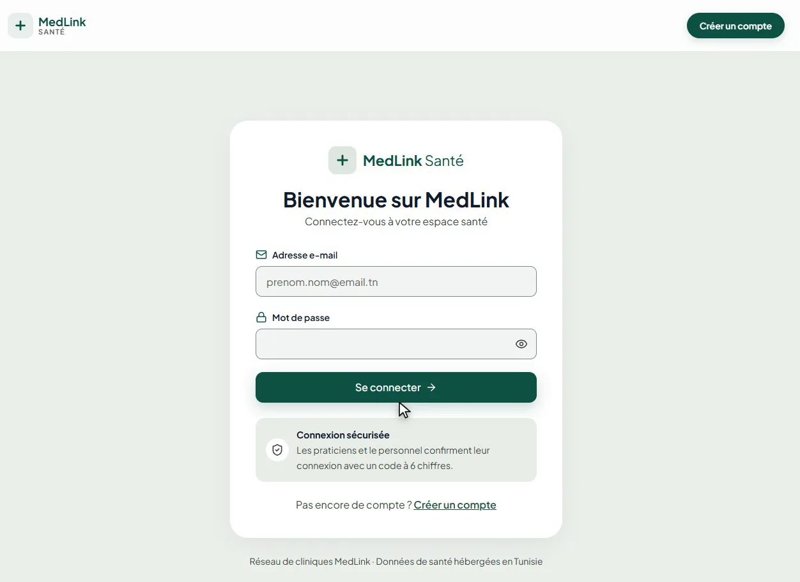
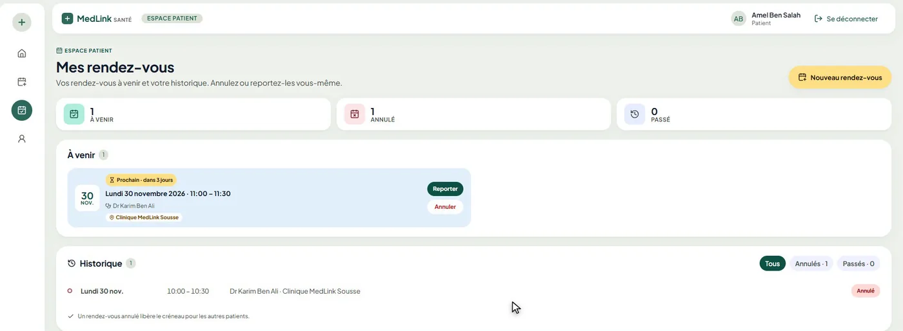
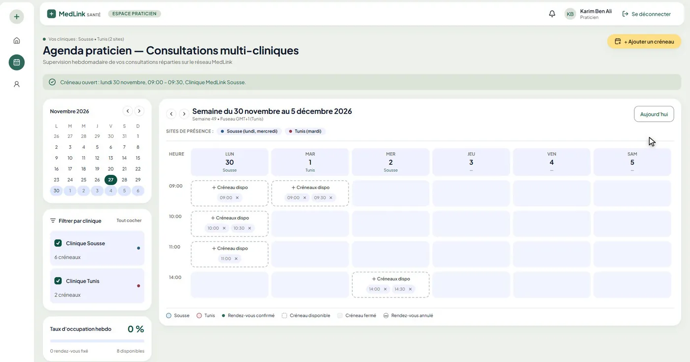
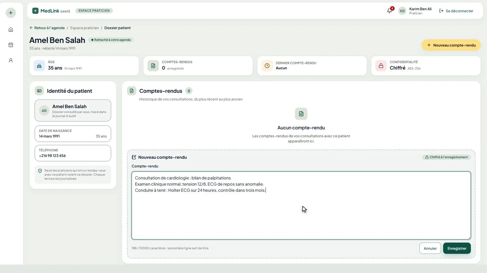
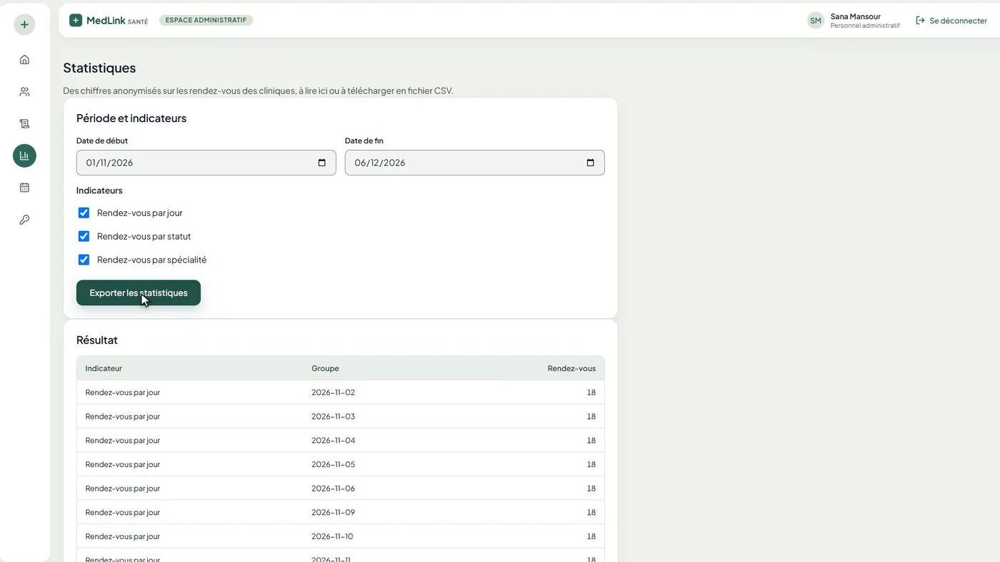

# MedLink — Web (front)

[](https://github.com/assali-mohamed-ali/medlink-dashboard/actions/workflows/ci.yml)
[](https://github.com/assali-mohamed-ali/medlink-dashboard/actions/workflows/container-security.yml)


Interface React du portail **MedLink** : patients, praticiens et personnel administratif de trois cliniques
(Sousse, Sfax, Tunis). Elle parle uniquement à notre API, [api-MedLink](https://github.com/assali-mohamed-ali/api-MedLink),
avec le cookie de session ; aucun token n'est stocké dans le navigateur, et le navigateur ne parle jamais à Keycloak.

| | |
|---|---|
| **Production** | https://med-l.ink |
| **Préproduction** | https://staging.med-l.ink |
| **Suivi** | YouTrack, projet `MLink` : https://medlink.youtrack.cloud |

## Sommaire

1. [Aperçu](#aperçu)
2. [Ce que fait l'application](#ce-que-fait-lapplication)
3. [Prérequis](#prérequis)
4. [Démarrer](#démarrer)
5. [Structure](#structure)
6. [Sécurité](#sécurité)
7. [Tests et contrôles](#tests-et-contrôles)
8. [Livraison](#livraison)
9. [Sentry (optionnel)](#sentry-optionnel)
10. [Documentation](#documentation)

## Aperçu

| Accueil public | Connexion |
|---|---|
|  |  |

| Patient : prendre un rendez-vous | Patient : mes rendez-vous |
|---|---|
|  |  |

| Praticien : agenda multi-cliniques | Praticien : compte rendu de consultation |
|---|---|
|  |  |

| Personnel : statistiques anonymisées | Praticiens et personnel : second facteur |
|---|---|
|  |  |

Captures de l'application (novembre 2026, données fictives), prises par Mohamed Ben Naima.

## Ce que fait l'application

| Espace | URL | Pages |
|---|---|---|
| Public | `/`, `/connexion`, `/inscription` | accueil, connexion, création d'un compte patient |
| Pages envoyées par mail | `/verifier-email`, `/configurer-code`, `/activer-compte` | vérification de l'adresse, configuration du code à 6 chiffres, activation d'un compte créé par le personnel (contrat de l'API : ne pas renommer) |
| Patient | `/patient` | accueil, créneaux libres par clinique, spécialité ou praticien, prise, annulation et report d'un rendez-vous, comptes rendus de consultation, documents, profil, mot de passe |
| Praticien | `/praticien` | agenda de la semaine et créneaux, alertes (cloche), dossier d'un patient suivi et comptes rendus de consultation, profil, mot de passe |
| Personnel administratif | `/admin` | accueil, gestion des comptes (création, rôle, statut, nom, changement de mot de passe imposé), dépôt des documents des patients, journal d'audit, rendez-vous des cliniques, statistiques anonymisées en CSV, profil, mot de passe |

Praticiens et personnel se connectent avec un mot de passe **et** un code à 6 chiffres (TOTP). Chaque espace est
protégé par rôle : un autre rôle arrive sur `/acces-refuse`.

## Prérequis

- Node 22.12 ou plus (voir `.nvmrc`). Sur Windows, installer Node 22 avec nvm-windows ou depuis le site officiel.
- L'API en local sur `http://localhost:8080` : dans le dépôt `api-MedLink`, lancer `scripts/setup-dev.ps1` (Windows)
  ou `scripts/setup-dev.sh` (voir le README de ce dépôt). Comptes de test : `patient.dev`, `practitioner.dev`,
  `staff.dev` (`@medlink.local`), mot de passe dans le README de l'API.

## Démarrer

```bash
npm ci
npm run dev      # http://localhost:3000 (le port des liens envoyés par mail)
npm test
npm run lint
npm run build
```

Le serveur de développement redirige `/api` vers `http://localhost:8080` : le navigateur ne voit qu'une origine, donc
pas de CORS et le cookie `XSRF-TOKEN` reste lisible. Il tourne sur le port 3000, l'`APP_FRONTEND_URL` de l'API en dev :
les liens des mails (vérification, configuration du code, activation) s'ouvrent ici.

L'image de production avec l'API, sur une seule origine :
`docker compose -f deploy/docker-compose.local.yml up --build -d`, puis http://localhost:8090. En staging et en prod,
le reverse proxy HTTPS (Caddy) route `/api` vers l'API : voir [deploy/README.md](deploy/README.md).

## Structure

- `src/app` : le câblage (la table des routes, le routeur)
- `src/spaces` : les espaces par rôle (patient, praticien, administratif) : une mise en page, un menu par rôle
- `src/features/<domaine>` : un dossier par domaine métier : appels API, types, pages, routes. Aujourd'hui `auth`,
  `mfa`, `profile`, `slots`, `my-reports`, `documents`, `agenda`, `alerts`, `patient-record`, `staff-home`,
  `accounts`, `audit`, `supervision`, `stats`
- `src/pages` : les pages sans domaine (accueil, accès refusé, page introuvable, erreur)
- `src/shared` : le code réutilisable sans métier (client API, messages d'erreur, URLs, composants UI, styles)

Les imports vont dans un seul sens : `app` → `spaces`/`pages` → `features` → `shared` ; `npm run lint` le vérifie.
Les URLs viennent de `src/shared/config/paths.ts`, les appels API d'un `api.ts` de feature via `apiFetch`.

## Sécurité

- **Uniquement un cookie de session HttpOnly** (et le cookie lisible `XSRF-TOKEN`) ; `apiFetch` renvoie le jeton CSRF
  sur chaque écriture. Rien sur la session dans le stockage du navigateur ; l'utilisateur connecté vient de
  `GET /api/auth/me`.
- **Jamais affiché ni journalisé :** mot de passe, code TOTP, jeton envoyé par mail, secret, réponse complète de l'API.
- **CSP `'self'`** (`deploy/nginx/security-headers.conf`) : toutes les ressources sont hébergées par l'application,
  aucun script, style, police ou image tiers.
- **Image servie par nginx**, non root ; staging derrière le WAF Caddy (OWASP CRS) côté API.

## Tests et contrôles

| Commande | Ce qu'elle vérifie |
|---|---|
| `npm test` | Vitest + Testing Library : une réponse de l'API par test, chaque page protégée avec le bon et un mauvais rôle |
| `npm run lint` | oxlint, dont le sens des imports entre dossiers |
| `npm run build` | TypeScript puis le build Vite |
| `npm run check:contrast` | le contraste des couleurs des jetons de design (accessibilité) |
| `npm run check:budget` | le budget JavaScript de la première visite |

Avant chaque push : `npm ci && npm test && npm run lint && npm run build`. Le hook pre-commit du dépôt s'installe une
fois (voir [CONTRIBUTING.md](CONTRIBUTING.md)) :

```bash
bash scripts/setup-pre-commit.sh
```

Il vérifie les fichiers indexés avant chaque commit ; la CI lance tous les hooks sur tout le dépôt.

## Livraison

| Événement | Résultat (`container-security.yml`) |
|---|---|
| PR | build de l'image, analyse Trivy de cette image exacte, SBOM ; rien n'est publié |
| Push sur `master` | publication de l'image analysée sur GHCR par empreinte, attestations (provenance, SBOM), signature Cosign |
| Push sur `staging` | vérification de la signature, déploiement en préproduction, test de fumée, attente du déploiement de l'API en préproduction |
| Puis, avec `AUTO_DEPLOY_PROD` (activé) | la **même empreinte vérifiée** est déployée en production, puis test de fumée |
| Push sur `prod` ou étiquette `v*` | chemin historique : déploiement de production depuis cette référence |

Les PR visent `master` (une PR par épopée, voir [CONTRIBUTING.md](CONTRIBUTING.md)). Secrets de déploiement : Vault
via OIDC GitHub, avec les secrets d'environnement GitHub en secours. Détails : [deploy/README.md](deploy/README.md).

## Sentry (optionnel)

Le SDK Sentry (React) ne démarre que si `VITE_SENTRY_DSN` est défini au build. En local, mettez-le dans
`.env.local` (ignoré par Git) :

    VITE_SENTRY_DSN=https://<clé-publique>@o<org>.ingest.sentry.io/<projet>

Le DSN est public ; sans lui, aucun événement ne quitte le navigateur. Le SDK est chargé dans un chunk séparé
pour rester dans le budget JavaScript de la première visite ; les erreurs du premier rendu attendent dans une
petite file jusqu'à son chargement.

En production, le Dockerfile et le workflow `container-security` utilisent déjà le DSN public du projet ; la
variable de dépôt `VITE_SENTRY_DSN` peut le remplacer. Pour des stack traces lisibles en production, définissez
aussi `SENTRY_AUTH_TOKEN`, `SENTRY_ORG` et `SENTRY_PROJECT` au build : le plugin Vite téléverse les source maps
puis les supprime de `dist/`. Le token est un secret. Ce projet est dans la région EU de Sentry : le Dockerfile et
le workflow utilisent `SENTRY_URL=https://de.sentry.io` par défaut, modifiable par la variable de dépôt
`SENTRY_URL`. Voir [deploy/README.md](deploy/README.md#sentry) et la CSP dans
`deploy/nginx/security-headers.conf`.

## Documentation

| Document | Contenu |
|---|---|
| [docs/ONBOARDING.md](docs/ONBOARDING.md) | le guide complet : premier lancement, architecture, flux d'une requête, sécurité, rôles, bibliothèque UI, tests, dépannage |
| [docs/MANUAL-TESTING.md](docs/MANUAL-TESTING.md) | tester à la main tous les parcours (inscription, connexion, code à 6 chiffres, espaces) |
| [deploy/README.md](deploy/README.md) | image, nginx, une seule origine, CI et livraison, configuration du déploiement, Sentry |
| [CONTRIBUTING.md](CONTRIBUTING.md) | règles d'équipe, branches d'épopée, hook pre-commit |
| [CLAUDE.md](CLAUDE.md) | les règles de l'équipe, pour les personnes et les sessions d'IA |
| [api-MedLink](https://github.com/assali-mohamed-ali/api-MedLink) | l'API : contrats des routes (`docs/sprints/sprint-2/plan.md` §4), environnement de développement |
