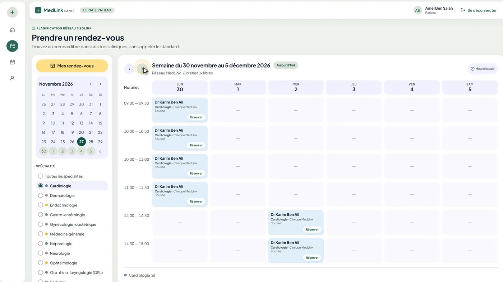
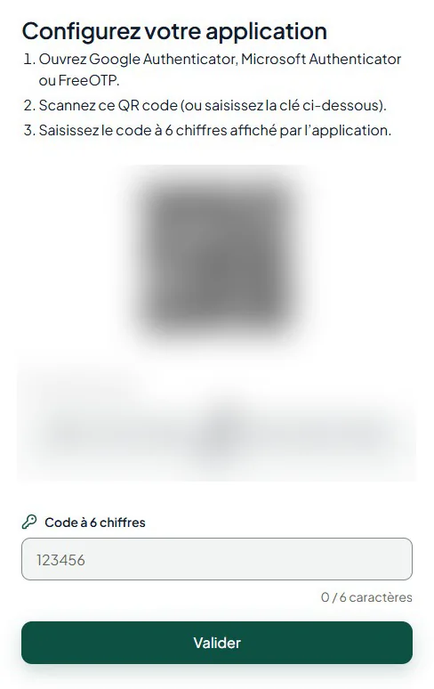

<p align="center">
  
</p>

<p align="center">
  <a href="https://github.com/assali-mohamed-ali/medlink-dashboard/actions/workflows/ci.yml"></a>
  <a href="https://github.com/assali-mohamed-ali/medlink-dashboard/actions/workflows/container-security.yml"></a>
  
  
  
  
</p>

<p align="center">
  <a href="https://med-l.ink"><b>Production</b></a> ·
  <a href="https://staging.med-l.ink"><b>Préproduction</b></a> ·
  <a href="https://github.com/assali-mohamed-ali/api-MedLink"><b>API</b></a> ·
  <a href="https://medlink.youtrack.cloud"><b>YouTrack</b></a> ·
  <a href="docs/ONBOARDING.md"><b>Guide d'accueil</b></a>
</p>

Interface React du portail **MedLink** pour les patients, les praticiens et le personnel administratif de trois
cliniques (Sousse, Sfax, Tunis). Elle parle uniquement à notre API,
[api-MedLink](https://github.com/assali-mohamed-ali/api-MedLink).

> [!IMPORTANT]
> **Le navigateur ne parle jamais à Keycloak** et ne garde aucun token : seulement un cookie de session HttpOnly et le
> cookie lisible `XSRF-TOKEN`. Toute l'identité passe par `/api/auth/...`.

<p align="center">
  
</p>

## Sommaire

[Aperçu](#aperçu) · [Fonctionnalités](#fonctionnalités) · [Démarrer](#démarrer) · [Structure](#structure) ·
[Sécurité](#sécurité) · [Tests et contrôles](#tests-et-contrôles) · [Livraison](#livraison) ·
[Documentation](#documentation)

## Aperçu

<table>
  <tr>
    <td width="50%" valign="top">
      <br>
      <b>Patient · prendre un rendez-vous</b><br>
      <sub>Les créneaux libres de la semaine, filtrés par clinique, spécialité ou praticien.</sub>
    </td>
    <td width="50%" valign="top">
      <br>
      <b>Patient · mes rendez-vous</b><br>
      <sub>À venir et historique ; annuler ou reporter en un clic.</sub>
    </td>
  </tr>
  <tr>
    <td width="50%" valign="top">
      <br>
      <b>Praticien · agenda multi-cliniques</b><br>
      <sub>La semaine du praticien dans ses cliniques, ses créneaux et son taux d'occupation.</sub>
    </td>
    <td width="50%" valign="top">
      <br>
      <b>Praticien · compte rendu de consultation</b><br>
      <sub>Le dossier d'un patient suivi ; le compte rendu est chiffré côté serveur.</sub>
    </td>
  </tr>
  <tr>
    <td width="50%" valign="top">
      <br>
      <b>Personnel · statistiques anonymisées</b><br>
      <sub>Indicateurs par période, téléchargés en CSV, sans aucune donnée nominative.</sub>
    </td>
    <td width="50%" valign="top">
      <br>
      <b>Connexion</b><br>
      <sub>Une page MedLink : le mot de passe part vers notre API, jamais vers Keycloak.</sub>
    </td>
  </tr>
</table>

<details>
<summary><b>Second facteur des praticiens et du personnel</b></summary>
<br>
<p align="center">
  <br>
  <sub>Configuration du code à 6 chiffres depuis le lien envoyé par mail (QR code masqué ici).</sub>
</p>
</details>

<sub>Captures de l'application (novembre 2026, données fictives), prises par Mohamed Ben Naima.</sub>

## Fonctionnalités

| Espace | Entrée | Ce qu'on y fait |
|---|---|---|
| **Public** | `/` · `/connexion` · `/inscription` | accueil, connexion, création d'un compte patient |
| **Liens envoyés par mail** | `/verifier-email` · `/configurer-code` · `/activer-compte` | vérifier l'adresse, configurer le code à 6 chiffres, activer un compte créé par le personnel |
| **Patient** | `/patient` | créneaux libres par clinique, spécialité ou praticien ; prendre, annuler, reporter un rendez-vous ; comptes rendus de consultation ; documents ; profil ; mot de passe |
| **Praticien** | `/praticien` | agenda de la semaine et créneaux ; alertes (cloche) ; dossier d'un patient suivi et comptes rendus ; profil ; mot de passe |
| **Personnel administratif** | `/admin` | comptes (création, rôle, statut, nom, mot de passe imposé) ; dépôt des documents des patients ; journal d'audit ; rendez-vous des cliniques ; statistiques en CSV ; profil ; mot de passe |

Praticiens et personnel se connectent avec un mot de passe **et** un code à 6 chiffres (TOTP). Chaque espace est
protégé par rôle : un autre rôle arrive sur `/acces-refuse`. Les trois pages envoyées par mail font partie du contrat
de l'API : ne pas les renommer.

## Démarrer

**Prérequis :** Node 22.12 ou plus (voir `.nvmrc` ; sur Windows, nvm-windows ou le site officiel) et l'API en local
sur `http://localhost:8080`.

1. **Lancer l'API** dans le dépôt `api-MedLink` : `scripts/setup-dev.ps1` (Windows) ou `scripts/setup-dev.sh`.
   Comptes de test : `patient.dev`, `practitioner.dev`, `staff.dev` (`@medlink.local`), mot de passe dans le README
   de l'API.
2. **Lancer le front :**

   ```bash
   npm ci
   npm run dev      # http://localhost:3000, le port des liens envoyés par mail
   ```

3. **Se connecter** sur http://localhost:3000/connexion.

Le serveur de développement redirige `/api` vers `http://localhost:8080` : une seule origine, donc pas de CORS et le
cookie `XSRF-TOKEN` reste lisible. Le port 3000 est l'`APP_FRONTEND_URL` de l'API en dev : les liens des mails
(vérification, code, activation) s'ouvrent ici.

> [!TIP]
> L'image de production avec l'API, sur une seule origine :
> `docker compose -f deploy/docker-compose.local.yml up --build -d`, puis http://localhost:8090.

## Structure

```text
src/
├── app/         le câblage : la table des routes, le routeur
├── spaces/      un espace par rôle (patient, praticien, administratif) : mise en page et menu
├── features/    un dossier par domaine : appels API, types, pages, routes
│                auth · mfa · profile · slots · my-reports · documents · agenda · alerts
│                patient-record · staff-home · accounts · audit · supervision · stats
├── pages/       les pages sans domaine : accueil, accès refusé, page introuvable, erreur
└── shared/      sans métier : client API, messages d'erreur, URLs, composants UI, styles
```

Les imports vont dans un seul sens, `app` → `spaces`/`pages` → `features` → `shared`, et `npm run lint` le vérifie.
Les URLs viennent de `src/shared/config/paths.ts`, les appels API d'un `api.ts` de feature via `apiFetch`.

## Sécurité

| Règle | Comment |
|---|---|
| Session | uniquement un cookie HttpOnly ; rien sur la session dans le stockage du navigateur ; l'utilisateur vient de `GET /api/auth/me` |
| CSRF | `apiFetch` renvoie le jeton `XSRF-TOKEN` dans `X-XSRF-TOKEN` à chaque écriture |
| Secrets | jamais affichés ni journalisés : mot de passe, code TOTP, jeton envoyé par mail, secret, réponse complète de l'API |
| CSP `'self'` | `deploy/nginx/security-headers.conf` : aucun script, style, police ou image tiers, tout est hébergé par l'application |
| Image | nginx non root (`nginx-unprivileged`, utilisateur 101), analysée par Trivy, signée avec Cosign |

## Tests et contrôles

| Commande | Ce qu'elle vérifie |
|---|---|
| `npm test` | Vitest + Testing Library : un test par réponse de l'API, chaque page protégée avec le bon et un mauvais rôle |
| `npm run lint` | oxlint, dont le sens des imports entre dossiers |
| `npm run build` | TypeScript puis le build Vite |
| `npm run check:contrast` | le contraste des couleurs des jetons de design (accessibilité) |
| `npm run check:budget` | le budget JavaScript de la première visite |

Avant chaque push : `npm ci && npm test && npm run lint && npm run build`. Le hook pre-commit s'installe une fois
(voir [CONTRIBUTING.md](CONTRIBUTING.md)) avec `bash scripts/setup-pre-commit.sh` ; la CI lance tous les hooks sur
tout le dépôt.

## Livraison

```text
PR ──► build + Trivy + SBOM          (rien n'est publié)
master ──► publication GHCR par empreinte, attestations, signature Cosign
staging ──► déploiement préproduction ──► test de fumée ──► attente de l'API en préproduction
        ──► même empreinte vérifiée en production ──► test de fumée      (AUTO_DEPLOY_PROD activé)
```

Les PR visent `master`, une par épopée (voir [CONTRIBUTING.md](CONTRIBUTING.md)).

<details>
<summary><b>Le détail de <code>container-security.yml</code></b></summary>
<br>

| Événement | Résultat |
|---|---|
| PR | build de l'image, analyse Trivy de cette image exacte, SBOM ; rien n'est publié |
| Push sur `master` | publication de l'image analysée sur GHCR par empreinte, attestations (provenance, SBOM), signature Cosign |
| Push sur `staging` | vérification de la signature, déploiement en préproduction, test de fumée, attente du déploiement de l'API en préproduction |
| Puis, avec `AUTO_DEPLOY_PROD` (activé) | la **même empreinte vérifiée** est déployée en production, puis test de fumée |
| Push sur `prod` ou étiquette `v*` | chemin historique : déploiement de production depuis cette référence |

Secrets de déploiement : Vault via OIDC GitHub, avec les secrets d'environnement GitHub en secours. En staging et en
prod, le reverse proxy HTTPS (Caddy) route `/api` vers l'API. Détails : [deploy/README.md](deploy/README.md).

</details>

<details>
<summary><b>Sentry (optionnel)</b></summary>
<br>

Le SDK Sentry (React) ne démarre que si `VITE_SENTRY_DSN` est défini au build. En local, mettez-le dans
`.env.local` (ignoré par Git) :

    VITE_SENTRY_DSN=https://<clé-publique>@o<org>.ingest.sentry.io/<projet>

Le DSN est public ; sans lui, aucun événement ne quitte le navigateur. Le SDK est chargé dans un chunk séparé
pour rester dans le budget JavaScript de la première visite ; les erreurs du premier rendu attendent dans une
petite file jusqu'à son chargement.

En production, le Dockerfile et le workflow `container-security` utilisent déjà le DSN public du projet ; la
variable de dépôt `VITE_SENTRY_DSN` peut le remplacer. Pour des stack traces lisibles en production, définissez
aussi `SENTRY_AUTH_TOKEN`, `SENTRY_ORG` et `SENTRY_PROJECT` au build : le plugin Vite téléverse les source maps
puis les supprime de `dist/`. Le token est un secret. Ce projet est dans la région EU de Sentry : le Dockerfile et
le workflow utilisent `SENTRY_URL=https://de.sentry.io` par défaut, modifiable par la variable de dépôt
`SENTRY_URL`. Voir [deploy/README.md](deploy/README.md#sentry) et la CSP dans
`deploy/nginx/security-headers.conf`.

</details>

## Documentation

| Document | Contenu |
|---|---|
| [docs/ONBOARDING.md](docs/ONBOARDING.md) | le guide complet : premier lancement, architecture, flux d'une requête, sécurité, rôles, bibliothèque UI, tests, dépannage |
| [docs/MANUAL-TESTING.md](docs/MANUAL-TESTING.md) | tester à la main tous les parcours (inscription, connexion, code à 6 chiffres, espaces) |
| [deploy/README.md](deploy/README.md) | image, nginx, une seule origine, CI et livraison, configuration du déploiement, Sentry |
| [CONTRIBUTING.md](CONTRIBUTING.md) | règles d'équipe, branches d'épopée, hook pre-commit |
| [CLAUDE.md](CLAUDE.md) | les règles de l'équipe, pour les personnes et les sessions d'IA |
| [api-MedLink](https://github.com/assali-mohamed-ali/api-MedLink) | l'API : contrats des routes (`docs/sprints/sprint-2/plan.md` §4), environnement de développement |

<p align="center"><sub>MedLink · projet du module Labs Cyber Security and Coding, ESPRIM 5CC1 · 2026–2027</sub></p>
