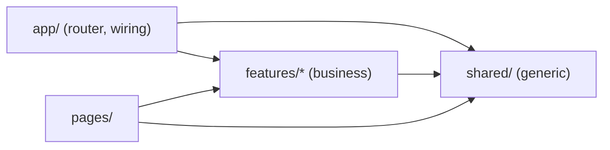
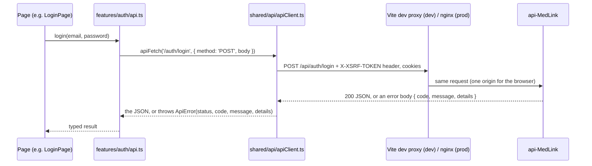

# MedLink dashboard — onboarding guide

Read this once before your first change. It tells you how to run the app, where things live, how a
screen talks to the API, and the rules every contributor follows. It is kept up to date in the same
commit as the code it describes: if you change a rule or a folder, change this file too.

- **What it is:** the React front of MedLink, a health portal for patients, practitioners and the
  administrative staff of three clinics. UI text is French; code, comments and docs are English.
- **What it talks to:** only our API, [`api-MedLink`](https://github.com/assali-mohamed-ali/api-MedLink)
  (Spring Boot). The API is the only component that talks to Keycloak. **The browser never sees
  Keycloak**: no Keycloak page, link or token, ever.

## 1. First run (about 5 minutes)

Prerequisites: Node 22 (`.nvmrc`; on Windows use nvm-windows or the official installer), Git, Docker
Desktop (for the API's dev stack).

1. Start the API's dev stack, in the `api-MedLink` repository:
   `scripts/setup-dev.ps1` (Windows) or `scripts/setup-dev.sh` (macOS/Linux). It starts PostgreSQL,
   Keycloak, Mailpit and the API on `http://localhost:8080`, and creates the dev accounts.
2. In this repository:

   ```bash
   npm ci          # exact versions from package-lock.json
   npm run dev     # http://localhost:5173
   ```

3. Log in with a dev account (password `MedLink-Dev-2026!`):

   | Account | Role | Space |
   |---|---|---|
   | `patient.dev@medlink.local` | `PATIENT` | `/patient` |
   | `practitioner.dev@medlink.local` | `PRACTITIONER` (+ TOTP code) | `/praticien` |
   | `staff.dev@medlink.local` | `ADMINISTRATIVE_STAFF` (+ TOTP code) | `/admin` |

4. Mails the API sends (verify e-mail, code setup link) arrive in **Mailpit**: `http://localhost:8025`.

Everyday commands:

| Command | What it does |
|---|---|
| `npm run dev` | Dev server with hot reload; `/api` is proxied to `http://localhost:8080` |
| `npm test` | Unit and component tests (Vitest + Testing Library), once |
| `npx vitest` | The same, in watch mode while you code |
| `npm run lint` | Oxlint |
| `npm run build` | Type-check (`tsc -b`) and production build into `dist/` |

CI runs pre-commit, lint, tests, build and `npm audit` on every pull request: run the same four
`npm` commands before you push.

## 2. Architecture map

```
src/
├─ main.tsx                 entry: providers + router
├─ app/                     wiring only: the router (and soon providers, paths, error pages)
├─ features/<domain>/       one folder per business area
│   └─ auth/                identity: login, signup, session, roles
│       ├─ api.ts           one function per API endpoint (the contract of api-MedLink plan.md §4)
│       ├─ types.ts         the shapes the API sends and receives
│       ├─ AuthProvider.tsx the session state (who is logged in), useAuth.ts to read it
│       ├─ roles.ts         the three roles and each role's home page
│       ├─ pages/           LoginPage, SignupPage (+ their .css and .test.tsx)
│       └─ index.ts         the feature's public API
├─ pages/                   pages that belong to no feature (Home, placeholders)
├─ shared/                  reusable code that knows nothing about MedLink's business
│   ├─ api/apiClient.ts     apiFetch() and ApiError: the only place that calls fetch()
│   ├─ api/errors.ts        messageFor(error), fieldErrors(details, fields): the French text to show
│   └─ layout/              PublicHeader, MedLinkShell
└─ test/setup.ts            test setup (jest-dom matchers, cleanup)
```

**Imports go one way:** `app` → `features` → `shared`.



- `shared/` never imports from `features/` or `app/`.
- Another folder imports a feature only through its `index.ts` (`import { useAuth } from '@/features/auth'`).
  Pages are the one exception: the router imports them directly so each can be lazy-loaded.
- Inside a feature, use relative imports (`'../api'`); across folders, use the `@/` alias
  (`'@/shared/api/apiClient'`). `@/` means `src/` (`tsconfig.app.json` `paths` + `vite.config.ts` `alias`).

## 3. How a screen talks to the API



- Pages never call `fetch()`. They call a function of their feature's `api.ts`, which calls `apiFetch`.
- Every API error body is `{ timestamp, status, error, code, message, details }`. `apiFetch` turns it
  into an `ApiError`: branch on `error.code` (stable, e.g. `EMAIL_NOT_VERIFIED`), show `error.message`
  (already French), and read `details` for field errors (`{ field: message }`).
- A 401 with code `UNAUTHENTICATED` or `SESSION_EXPIRED` means "the session is over"; any other 401 is
  a normal answer (wrong password, wrong code).

### Error handling: one path

| Layer | Its job |
|---|---|
| `apiFetch` | Every failure becomes an `ApiError`. No answer at all → `NETWORK_ERROR`; no answer within 15 s → `TIMEOUT` (both with status `0`). |
| `messageFor(error)` (`shared/api/errors.ts`) | The French text to show for any error: our own wording for the few codes a screen words itself (`INVALID_CODE`, `MFA_LOCKED`, `TOKEN_EXPIRED`, `INVALID_TOKEN`), otherwise the API's message, otherwise a generic one. |
| `fieldErrors(error.details, FIELDS)` | The per-field messages of a 400 `VALIDATION_FAILED`, kept only for the fields your form shows. |
| The page | Branches on `error.code` when the screen must change (e.g. `EMAIL_NOT_VERIFIED` shows "Renvoyer le lien"), shows `messageFor(error)` in an element with `role="alert"`. |

```ts
try {
  await login(email, password)
} catch (error) {
  if (error instanceof ApiError && error.code === 'EMAIL_NOT_VERIFIED') setNeedsVerification(true)
  setFormError(messageFor(error))   // never a hard-coded string, never error.stack
}
```

Need your own wording for a code? Add one line to `MESSAGES` in `shared/api/errors.ts`; don't repeat a
message the API already sends in French.

## 4. Session and security model

- **One cookie, no tokens.** After login the API sets an HttpOnly session cookie the JavaScript cannot
  read. Keycloak's tokens stay on the server. Never store anything about the session in
  `localStorage` or `sessionStorage`.
- **CSRF.** The API also sets a readable `XSRF-TOKEN` cookie (`GET /api/auth/csrf`). Every write (POST,
  PUT, PATCH, DELETE) must send it back in the `X-XSRF-TOKEN` header. `apiFetch` does both for you: when
  there is no cookie yet, it calls `/auth/csrf` first (once, even for parallel writes), then sends the
  header. Pages never deal with CSRF.
- **Same origin.** In dev, Vite proxies `/api` to the API, so the browser sees one origin: no CORS, and
  the `SameSite=Strict` cookies are sent.
- **Who is logged in** comes from the API (`GET /api/auth/me`), never from the browser's memory of a
  past login. The front hides screens a role cannot use, but **the API is the real check**: every
  endpoint enforces the role server side.
- **Never** log or display a password, a TOTP code, a token from a mail link, or a full API response.

## 5. Where do I put…?

| I want to… | Put it in |
|---|---|
| a new screen of an existing area | `features/<area>/pages/XxxPage.tsx` (+ `.css`, `.test.tsx`) |
| a call to a new endpoint | a function in `features/<area>/api.ts`, its types in `types.ts` |
| a new business area | a new `features/<area>/` with `api.ts`, `types.ts`, `pages/`, `index.ts` |
| a component used by one feature | `features/<area>/components/` (create it when needed) |
| a component used by two features or more | `shared/` (it must not mention MedLink's business) |
| a route | `app/router.tsx` |

## 6. Tests

- Each page has a `.test.tsx` next to it. Test what the user sees: find elements by role and label
  (`getByRole('button', { name: … })`, `getByLabelText(…)`), not by CSS class.
- Mock the API at the feature's `api.ts`, never `fetch` in a page test:

  ```ts
  vi.mock('../api', () => ({ login: vi.fn(), fetchCsrf: vi.fn() }))
  const login = vi.mocked(api.login)
  login.mockRejectedValue(new ApiError(401, 'INVALID_CREDENTIALS', 'E-mail ou mot de passe incorrect…'))
  ```

- One test per answer the API can give (200 and each error code of the contract).
- `shared/api/apiClient.test.ts` is the only test that mocks `fetch` itself.

## 7. Troubleshooting

| Symptom | Cause and fix |
|---|---|
| Every write answers **403** `FORBIDDEN` | The `X-XSRF-TOKEN` header is missing or stale. Call the API only through `apiFetch` (it fetches the cookie itself); check in the browser's dev tools that the `XSRF-TOKEN` cookie exists for `localhost`. |
| Logged in, but a refresh shows the login page | `GET /api/auth/me` is not on the API's `master` yet (MLink-53, in progress). |
| A link from a mail opens the wrong port | The API builds links from `APP_FRONTEND_URL` (`http://localhost:3000` in dev) while Vite runs on 5173. Being fixed in MLink-128 (Vite moves to 3000). |
| `npm run dev` shows network errors | The API is not running on `localhost:8080`: start its dev stack. |
| A test can't find a label | Required labels end with `*`: match the start with a regex, `getByLabelText(/^Prénom/)`. |

## 8. Glossary

- **BFF (Backend For Frontend):** our API logs users in with Keycloak on their behalf and keeps the
  tokens; the browser only holds a session cookie.
- **CSRF:** a forged request from another site using the user's cookies; blocked by the
  `X-XSRF-TOKEN` header that only our pages can read and send.
- **TOTP:** the 6-digit code from an authenticator app (Google Authenticator, FreeOTP…), asked of
  practitioners and staff after their password.
- **Space:** the part of the app for one role (`/patient`, `/praticien`, `/admin`).

## 9. Work in progress (MLink-128)

This foundation is being built on PR #11. Coming next, and documented here as each lands: a UI component library, role spaces with guards, the MFA screens
(MLink-64), the verify-e-mail page (MLink-80), and the production nginx setup.
