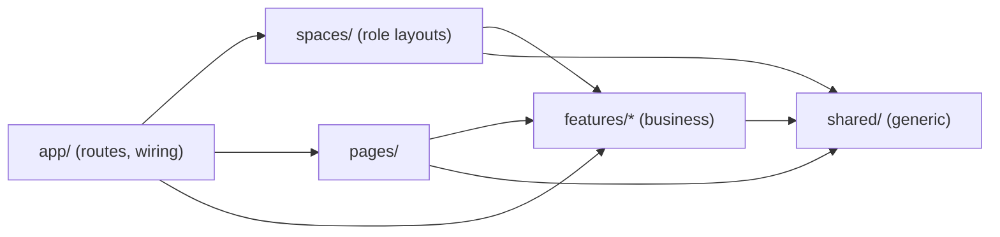
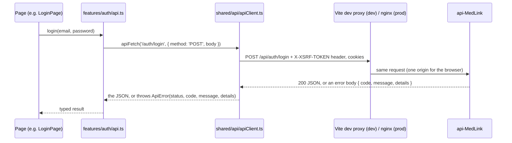
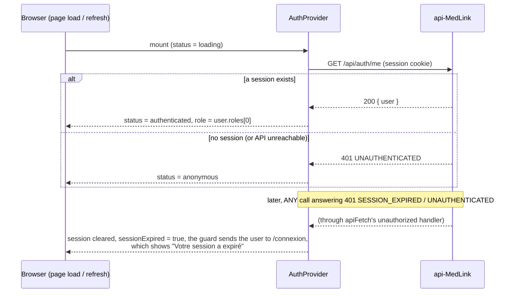
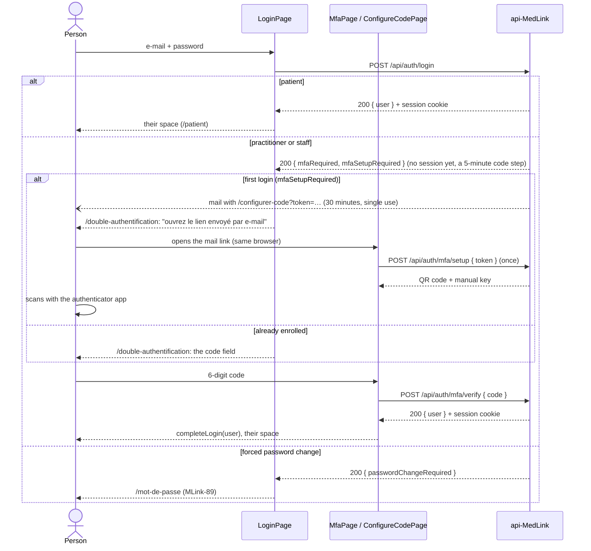
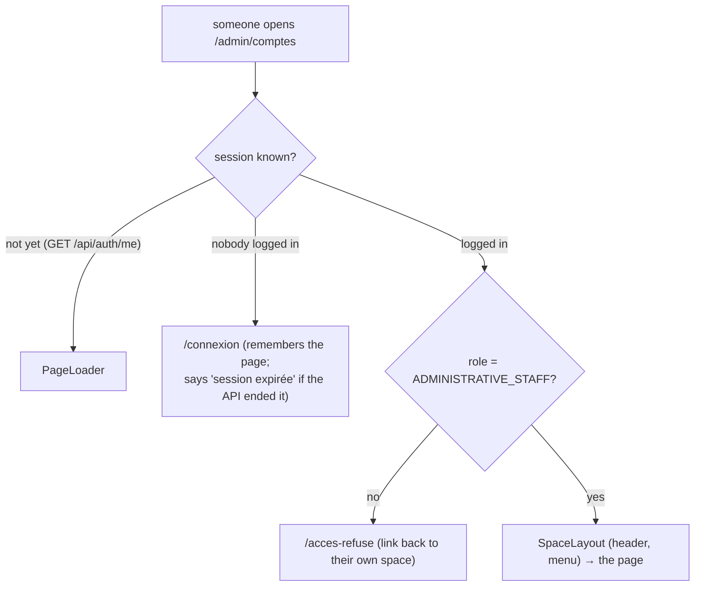

# MedLink dashboard — onboarding guide

Read this once before your first change. It tells you how to run the app, where things live, how a
screen talks to the API, and the rules every contributor follows. It is kept up to date in the same
commit as the code it describes: if you change a rule or a folder, change this file too.

- **What it is:** the React front of MedLink, a health portal for patients, practitioners and the
  administrative staff of three clinics. UI text is French; code, comments and docs are English.
- **What it talks to:** only our API, [`api-MedLink`](https://github.com/assali-mohamed-ali/api-MedLink)
  (Spring Boot). The API is the only component that talks to Keycloak. **The browser never sees
  Keycloak**: no Keycloak page, link or token, ever.

## 1. First run (about 5 minutes)

Prerequisites: Node 22 (`.nvmrc`; on Windows use nvm-windows or the official installer), Git, Docker
Desktop (for the API's dev stack).

1. Start the API's dev stack, in the `api-MedLink` repository:
   `scripts/setup-dev.ps1` (Windows) or `scripts/setup-dev.sh` (macOS/Linux). It starts PostgreSQL,
   Keycloak, Mailpit and the API on `http://localhost:8080`, and creates the dev accounts.
2. In this repository:

   ```bash
   npm ci          # exact versions from package-lock.json
   npm run dev     # http://localhost:3000
   ```

3. Log in with a dev account (password `MedLink-Dev-2026!`):

   | Account | Role | Space |
   |---|---|---|
   | `patient.dev@medlink.local` | `PATIENT` | `/patient` |
   | `practitioner.dev@medlink.local` | `PRACTITIONER` (+ TOTP code) | `/praticien` |
   | `staff.dev@medlink.local` | `ADMINISTRATIVE_STAFF` (+ TOTP code) | `/admin` |

4. Mails the API sends (verify e-mail, code setup link) arrive in **Mailpit**: `http://localhost:8025`.
5. To check every flow by hand (signup, login, code setup with an authenticator app, spaces, guards), follow
   **[MANUAL-TESTING.md](MANUAL-TESTING.md)**.

Everyday commands:

| Command | What it does |
|---|---|
| `npm run dev` | Dev server with hot reload on **port 3000** (the API mails links to it); `/api` is proxied to `http://localhost:8080` |
| `npm run build && npm run preview` | The production build, served on port 3000 with the same `/api` proxy |
| `npm test` | Unit and component tests (Vitest + Testing Library), once |
| `npx vitest` | The same, in watch mode while you code |
| `npm run lint` | Oxlint |
| `npm run build` | Type-check (`tsc -b`) and production build into `dist/` |

CI runs pre-commit, lint, tests, build and `npm audit` on every pull request: run the same four
`npm` commands before you push.

## 2. Architecture map

```
src/
├─ main.tsx                 entry: providers + router
├─ app/                     wiring only
│   ├─ routes.tsx           the whole route table: public pages, one branch per role space, 404
│   └─ router.ts            the browser router built from routes.tsx
├─ spaces/                  the role spaces: one layout, configured per role
│   ├─ spaces.ts            SPACES: each role's title and menu (data only)
│   ├─ SpaceLayout.tsx      header (title, who is logged in, logout) + menu + <Outlet />
│   └─ SpaceHome.tsx        the first page of a space
├─ features/<domain>/       one folder per business area
│   ├─ mfa/                 the code step of practitioners and staff (MLink-64)
│   │   ├─ api.ts           setupMfa(token), verifyMfa(code)
│   │   ├─ components/      CodeForm: the 6-digit code, shared by both pages
│   │   └─ pages/           MfaPage (/double-authentification), ConfigureCodePage (/configurer-code)
│   └─ auth/                identity: login, signup, session, roles, guards
│       ├─ api.ts           one function per API endpoint (the contract of api-MedLink plan.md §4)
│       ├─ types.ts         the shapes the API sends and receives
│       ├─ AuthProvider.tsx the session state (who is logged in), useAuth.ts to read it
│       ├─ guards.tsx       RequireAuth (logged in, optional role), GuestOnly (visitors only)
│       ├─ roles.ts         the three roles and each role's home page
│       ├─ routes.tsx       the feature's routes (lazy pages)
│       ├─ pages/           LoginPage, SignupPage, VerifyEmailPage (+ their styles and .test.tsx)
│       └─ index.ts         the feature's public API
├─ pages/                   pages of no feature: Home, AccessDenied, NotFound, RouteError, placeholders
├─ shared/                  reusable code that knows nothing about MedLink's business
│   ├─ api/apiClient.ts     apiFetch() and ApiError: the only place that calls fetch()
│   ├─ api/errors.ts        messageFor(error), fieldErrors(details, fields): the French text to show
│   ├─ config/paths.ts      every URL of the app, once
│   ├─ lib/                 lazyPage (lazy routes), useTokenFromUrl, useSingleRequest (pages opened from a mail)
│   ├─ layout/              PublicHeader, MedLinkShell
│   ├─ styles/              tokens.css (colours, radii, shadows, type), global.css
│   └─ ui/                  our component library: Button, TextField, PasswordField, Alert, Spinner, PageLoader
└─ test/setup.ts            test setup (jest-dom matchers, cleanup)
```

**Imports go one way:** `app` → `spaces` / `pages` → `features` → `shared`.



- `shared/` never imports from any other folder; a feature never imports from `app/`, `spaces/` or `pages/`.
- Another folder imports a feature only through its `index.ts` (`import { useAuth } from '@/features/auth'`).
  Pages are the one exception: routes load them lazily (`lazyPage(() => import('./pages/LoginPage'))`) so
  each page is its own download.
- **No URL strings in code:** use `paths` (`navigate(paths.login)`, `<Link to={paths.signup}>`). The pages the
  API mails (`verifyEmail`, `configureCode`, `activateAccount`) are part of the API contract: never rename them.
- Inside a feature, use relative imports (`'../api'`); across folders, use the `@/` alias
  (`'@/shared/api/apiClient'`). `@/` means `src/` (`tsconfig.app.json` `paths` + `vite.config.ts` `alias`).

## 3. How a screen talks to the API



- Pages never call `fetch()`. They call a function of their feature's `api.ts`, which calls `apiFetch`.
- Every API error body is `{ timestamp, status, error, code, message, details }`. `apiFetch` turns it
  into an `ApiError`: branch on `error.code` (stable, e.g. `EMAIL_NOT_VERIFIED`), show `error.message`
  (already French), and read `details` for field errors (`{ field: message }`).
- A 401 with code `UNAUTHENTICATED` or `SESSION_EXPIRED` means "the session is over"; any other 401 is
  a normal answer (wrong password, wrong code).

### Error handling: one path

| Layer | Its job |
|---|---|
| `apiFetch` | Every failure becomes an `ApiError`. No answer at all → `NETWORK_ERROR`; no answer within 15 s → `TIMEOUT` (both with status `0`). |
| `messageFor(error)` (`shared/api/errors.ts`) | The French text to show for any error: our own wording for the few codes a screen words itself (`INVALID_CODE`, `MFA_LOCKED`, `TOKEN_EXPIRED`, `INVALID_TOKEN`), otherwise the API's message, otherwise a generic one. |
| `fieldErrors(error.details, FIELDS)` | The per-field messages of a 400 `VALIDATION_FAILED`, kept only for the fields your form shows. |
| The page | Branches on `error.code` when the screen must change (e.g. `EMAIL_NOT_VERIFIED` shows "Renvoyer le lien"), shows `messageFor(error)` in an element with `role="alert"`. |

```ts
try {
  await login(email, password)
} catch (error) {
  if (error instanceof ApiError && error.code === 'EMAIL_NOT_VERIFIED') setNeedsVerification(true)
  setFormError(messageFor(error))   // never a hard-coded string, never error.stack
}
```

Need your own wording for a code? Add one line to `MESSAGES` in `shared/api/errors.ts`; don't repeat a
message the API already sends in French.

## 4. Session and security model

- **One cookie, no tokens.** After login the API sets an HttpOnly session cookie the JavaScript cannot
  read. Keycloak's tokens stay on the server. Never store anything about the session in
  `localStorage` or `sessionStorage`.
- **CSRF.** The API also sets a readable `XSRF-TOKEN` cookie (`GET /api/auth/csrf`). Every write (POST,
  PUT, PATCH, DELETE) must send it back in the `X-XSRF-TOKEN` header. `apiFetch` does both for you: when
  there is no cookie yet, it calls `/auth/csrf` first (once, even for parallel writes), then sends the
  header. Pages never deal with CSRF.
- **Same origin.** In dev, Vite proxies `/api` to the API, so the browser sees one origin: no CORS, and
  the `SameSite=Strict` cookies are sent.
- **Who is logged in** comes from the API (`GET /api/auth/me`), never from the browser's memory of a
  past login. The front hides screens a role cannot use, but **the API is the real check**: every
  endpoint enforces the role server side.
- **Never** log or display a password, a TOTP code, a token from a mail link, or a full API response.

### The session in the front: `useAuth()`

```ts
const { status, user, role, sessionExpired, login, completeLogin, logout } = useAuth()
```

| Field | Meaning |
|---|---|
| `status` | `loading` (asking the API on page load) · `anonymous` · `authenticated` |
| `user` | the API's user object `{ id, email, firstName, lastName, roles }`, or `null` |
| `role` | the person's **one** role (`PATIENT`, `PRACTITIONER`, `ADMINISTRATIVE_STAFF`), or `null` |
| `sessionExpired` | `true` after the API ended the session, until the next login |
| `login(email, password)` | `POST /api/auth/login`; opens the session when the answer holds `user` (patients) |
| `completeLogin(user)` | opens the session with the user a later step returned (`POST /api/auth/mfa/verify`) |
| `logout()` | `POST /api/auth/logout`; clears the session even if the call fails |



- Never keep your own copy of "who is logged in" (no `useState(user)` in a page, nothing in storage):
  read `useAuth()`.
- Wait for `status !== 'loading'` before deciding anything about access (the guards do this and show
  a `PageLoader`).

## 5. The login flows



| Answer at the code step | What the screen does |
|---|---|
| 401 `INVALID_CODE` | "Code incorrect", clears the field, stays |
| 423 `MFA_LOCKED` (5th wrong code, 15 minutes, across logins) | explains, hides the form, link back to login |
| 401 `UNAUTHORIZED` (the 5 minutes are over) | back to `/connexion`, which says "Votre étape de connexion a expiré" |
| setup: 400 `INVALID_TOKEN`, 410 `TOKEN_EXPIRED` | explains, "Se reconnecter" (a new login mails a new link, at most one per 15 minutes) |
| setup: 409 `MFA_ALREADY_ENROLLED` | "déjà configurée", link to the code field |
| setup: 401 `UNAUTHORIZED` | back to `/connexion` with the token **in memory** (router state); after the password, back to the setup |

### Pages opened from a mailed link

`/verifier-email?token=` (signup, MLink-80), `/configurer-code?token=` (code setup) and, later,
`/activer-compte?token=` all do the same two things, with two shared hooks:

```tsx
const token = useTokenFromUrl()                         // reads ?token= once, removes it from the address bar
const verification = useSingleRequest(verifyEmail, token) // calls verifyEmail(token) once: idle / pending / done / failed
```

The verify-e-mail page then shows: `pending` → loader; `done` → "Votre adresse e-mail est confirmée" + login
link; `failed` (400 `INVALID_TOKEN`, 410 `TOKEN_EXPIRED`) or no token → the reason + "Recevoir un nouveau lien"
(`POST /api/auth/verify-email/resend`, whose answer is the same whatever the address: never tell whether an
account exists).

Security rules these pages follow (keep them when you touch them):
- The mail token leaves the address bar as soon as the page reads it (history, screenshots, shared screens).
- The call runs **once** (`useSingleRequest`): a mailed token is single use (a second verify answers 410) and a
  second setup replaces the secret behind the QR code. React's StrictMode runs effects twice in development;
  the hook keeps the request in a `useRef` so both runs wait for the same one.
- Only an inline `data:image/png;base64,…` QR is displayed, never an address from the answer.
- The code, the token and the secret are never logged or stored.

## 6. Role spaces and route guards (RBAC)

Each role has **one space**, a branch of the route table with **one guard and one layout at its top**:

| Role | Space | Title |
|---|---|---|
| `PATIENT` | `/patient` | Espace patient |
| `PRACTITIONER` | `/praticien` | Espace praticien |
| `ADMINISTRATIVE_STAFF` | `/admin` | Espace administratif |



- `RequireAuth role="…"` guards a whole space (`app/routes.tsx`, function `space()`): a page added under a
  space cannot forget the check. `RequireAuth` without `role` = any logged-in person.
- `GuestOnly` wraps login and signup: a logged-in person is sent to their space.
- **The front's guards are for comfort, the API is the security**: every endpoint checks the role server
  side. Never show data because "the guard already checked"; let the API answer 403.
- A route that crashes or fails to load shows `RouteErrorPage` (never the error itself); an unknown URL shows
  `NotFoundPage`.

### Recipe: add a page to a space

1. Create the page in its feature: `features/appointments/pages/MyAppointmentsPage.tsx` (+ `.test.tsx`).
2. Add its URL to `shared/config/paths.ts`: `patient: { root: '/patient', appointments: '/patient/rendez-vous' }`.
3. Add the route under the space in `app/routes.tsx`:
   `space('PATIENT', paths.patient.root, [{ path: paths.patient.appointments, lazy: lazyPage(() => import('@/features/appointments/pages/MyAppointmentsPage')) }])`.
   (When a feature has several routes, export them from `features/x/routes.tsx` like `authRoutes`.)
4. Add the menu entry in `spaces/spaces.ts`: `{ label: 'Mes rendez-vous', to: paths.patient.appointments }`.
5. Test it in `app/routes.test.tsx` style: the right role sees it, another role gets "Accès refusé".

### Recipe: add a public page

Add the URL to `paths.ts`, the page in its feature, and the route in the feature's `routes.tsx` (inside
`GuestOnly` if a logged-in person has nothing to do there).

## 7. Our UI library (`shared/ui`) and design tokens

Build screens from these, not from raw `<input>`/`<button>` with page CSS:

| Component | Use it for | Accessibility it gives you for free |
|---|---|---|
| `Button` | every button; `variant` `primary` / `secondary` / `ghost`, `fullWidth`, `loading` | `type="button"` by default (no accidental submit); `loading` disables it and sets `aria-busy` |
| `TextField` | every text input; `label`, `hint`, `error` | label linked to the input, `aria-invalid`, hint and error read with the field, error announced (`role="alert"`) |
| `PasswordField` | passwords | everything of `TextField` + a show/hide toggle (`aria-pressed`, French labels) |
| `Alert` | messages: `tone` `error` / `success` / `info` | error interrupts the screen reader (`role="alert"`), the others wait (`role="status"`) |
| `Spinner`, `PageLoader` | something is loading | announced as "Chargement…" (or your `label`) |

```tsx
import { Alert, Button, PasswordField, TextField } from '@/shared/ui'

<form onSubmit={handleSubmit(onSubmit)} noValidate>
  {formError && <Alert tone="error">{formError}</Alert>}
  <TextField label="Adresse e-mail" type="email" error={errors.email?.message} {...register('email')} />
  <PasswordField label="Mot de passe" error={errors.password?.message} {...register('password')} />
  <Button type="submit" fullWidth loading={isSubmitting}>Se connecter</Button>
</form>
```

- Every native prop passes through (`autoComplete`, `onChange`, `ref`…), so `{...register('field')}` from
  react-hook-form just works.
- **Styles:** components use CSS Modules (`X.module.css`, class names can't clash) and only
  `var(--token)` values from `shared/styles/tokens.css`. Never a raw colour in a component: change the
  token and the whole app follows. Page layout CSS (`LoginPage.css`) is fine for page-specific layout.
- **Adding a component:** start it inside your feature (`features/x/components/`). Move it to
  `shared/ui` the second time another feature needs it, with a test (label, error, keyboard) and a line
  in `shared/ui/index.ts` and in this table.
- `HomePage.css`, `MedLinkShell.css` and `PublicHeader.css` still hold local copies of the same token
  values (from before `tokens.css`); new code reads the tokens.

### Tokens: type, colour, space (`shared/styles/tokens.css`)

The UI refresh (docs/ui-refresh/PLAN.md §4) set one scale for each; read a token, never write a raw value.

| Group | Tokens | Rule |
|---|---|---|
| Faces | `--font-sans` (Geist), `--font-display` (Instrument Serif) | the display face only for public and auth titles ≥ 32 px; never in forms, tables or spaces. Both load once from `fonts.css` (self-hosted, Latin only) |
| Sizes | `--text-xs`…`--text-3xl` with `--leading-*`, `--display-sm`, `--display-lg` | body and inputs `--text-md` (16 px); weights 400 text, 500 labels and buttons, 600 headings |
| Greys | `--bg`, `--surface-raised`, `--surface-sunken`, `--border`, `--border-strong`, `--text-muted` | `--border` is for dividers only; a field or control edge uses `--border-strong` (3:1). Old names (`--surface`, `--outline-variant`…) are aliases: new code uses the new names |
| Space, shape, depth, motion | `--space-1`…`--space-12` (4 → 96 px), `--radius-*`, `--elev-1..3`, `--duration-*`, `--ease` | 3 shadow levels only; animate `opacity` and `transform` only |

`npm run check:contrast` (`scripts/contrast.mjs`, also in CI) checks every text pair at 4.5:1 and every edge at 3:1.
A new text or edge colour gets its pair added there. Numbers in lists and tables take `.tabular-nums`.

### Watermelon UI and shadcn/ui (`shared/components`)

For richer pieces (sidebars, menus, dialogs, dashboards) we take components from
[Watermelon UI](https://ui.watermelon.sh) or [shadcn/ui](https://ui.shadcn.com) instead of writing them from scratch.
They are copied into the repo (we own and review the code), styled with Tailwind CSS 4, built on Base UI primitives
(`@base-ui/react`) and already painted in MedLink's colours.

| Folder | What lives there |
|---|---|
| `shared/ui/` | our own components (CSS Modules): `Button`, `TextField`… as above |
| `shared/components/ui/` | shadcn primitives (`button.tsx`…), added by the shadcn CLI |
| `shared/components/watermelon/` | Watermelon items, added the same way |

```bash
npx shadcn@4.23.0 add button                                            # a shadcn primitive
npx shadcn@4.23.0 add https://registry.watermelon.sh/r/<slug>.json      # a Watermelon item (slug from its page)
npx shadcn@4.23.0 add https://registry.watermelon.sh/r/<slug>.json --dry-run --view   # look before you add
```

How it is wired, and the traps:
- **Never run `shadcn init`**: it writes its own `--primary`/`--secondary` and would repaint the app. Everything is
  already configured (`components.json`, `shared/styles/tailwind.css`, the Vite plugin).
- **Colours**: Tailwind's `bg-primary`, `text-muted-foreground`, `border-border`… point at our tokens (`@theme` in
  `tailwind.css`). Our `--secondary` is a *text* colour; shadcn code that writes `var(--secondary)` must use
  `var(--secondary-fixed)`: `shared/components/shadcnTokens.test.ts` fails until you fix it.
- **No reset, limited scan**: Tailwind's preflight is off and it reads class names in `shared/components` only, so the
  existing pages are untouched. A new folder that uses Tailwind classes needs an `@source` line in `tailwind.css`.
- **Dependencies**: read what `add` installs. Prefer a version at least two weeks old; `cn` (shadcn's class merger)
  is pinned to an exact version for that reason. Explain each new package in the PR (why, size, alternative).
- **CSP**: Tailwind compiles into our own CSS file, fine for `'self'`. A primitive that injects a `<style>` element
  (some scroll locks, toasts) is blocked by the CSP: after adding a dialog, menu or toast, check the console of the
  production image (`http://localhost:8090`) for CSP errors before you open the PR.
- **Wrap before use in pages**: a page imports a Watermelon/shadcn piece through `shared/components` (or a feature
  wrapper with French texts and our props), never straight from a registry URL. Text stays French; icons stay
  `lucide-react`.

## 8. Where do I put…?

| I want to… | Put it in |
|---|---|
| a new screen of an existing area | `features/<area>/pages/XxxPage.tsx` (+ `.css`, `.test.tsx`) |
| a call to a new endpoint | a function in `features/<area>/api.ts`, its types in `types.ts` |
| a new business area | a new `features/<area>/` with `api.ts`, `types.ts`, `pages/`, `index.ts` |
| a component used by one feature | `features/<area>/components/` (create it when needed) |
| a component used by two features or more | `shared/ui/` (it must not mention MedLink's business) |
| a URL | `shared/config/paths.ts` (then use `paths.x`, never the string) |
| a route | the feature's `routes.tsx`, or the space's list in `app/routes.tsx` |
| a space menu entry | `spaces/spaces.ts` |

## 9. Tests

- Each page has a `.test.tsx` next to it. Test what the user sees: find elements by role and label
  (`getByRole('button', { name: … })`, `getByLabelText(…)`), not by CSS class.
- Mock the API at the feature's `api.ts`, never `fetch` in a page test:

  ```ts
  vi.mock('../api', () => ({ login: vi.fn(), fetchCsrf: vi.fn() }))
  const login = vi.mocked(api.login)
  login.mockRejectedValue(new ApiError(401, 'INVALID_CREDENTIALS', 'E-mail ou mot de passe incorrect…'))
  ```

- One test per answer the API can give (200 and each error code of the contract).
- `shared/api/apiClient.test.ts` is the only test that mocks `fetch` itself.

## 10. Troubleshooting

| Symptom | Cause and fix |
|---|---|
| Every write answers **403** `FORBIDDEN` | The `X-XSRF-TOKEN` header is missing or stale. Call the API only through `apiFetch` (it fetches the cookie itself); check in the browser's dev tools that the `XSRF-TOKEN` cookie exists for `localhost`. |
| Logged in, but a refresh shows the login page | Your API is older than MLink-53 (`GET /api/auth/me`): pull the API's `master` and restart it. |
| A link from a mail does not open the app | The API builds links from `APP_FRONTEND_URL` (`http://localhost:3000` in dev): run `npm run dev` (port 3000, `strictPort`; if 3000 is taken, free it). |
| `npm run dev` fails with "Port 3000 is in use" | Another app holds 3000; stop it (the port must match the mail links). |
| An API call answers `502 API_NOT_ROUTED` (staging/prod or the local `edge`) | The reverse proxy sends `/api` to the dashboard instead of the API: see `deploy/README.md`. |
| Behind a proxy (staging/prod or `localhost:8090`), every call answers **403 `Invalid CORS request`** | The API does not see the browser's own scheme, host and port, so it takes the page for another site. The proxy must send `X-Forwarded-Proto`, and `X-Forwarded-Port` on any port but 443: `deploy/README.md`. |
| The browser console shows "Refused to load … Content-Security-Policy" | The production CSP allows our own origin only. Self-host the file (as the home page images) instead of loosening the CSP. |
| `npm run dev` shows network errors | The API is not running on `localhost:8080`: start its dev stack. |
| A test can't find a label | Required labels end with `*`: match the start with a regex, `getByLabelText(/^Prénom/)`. |

## 11. Glossary

- **BFF (Backend For Frontend):** our API logs users in with Keycloak on their behalf and keeps the
  tokens; the browser only holds a session cookie.
- **CSRF:** a forged request from another site using the user's cookies; blocked by the
  `X-XSRF-TOKEN` header that only our pages can read and send.
- **TOTP:** the 6-digit code from an authenticator app (Google Authenticator, FreeOTP…), asked of
  practitioners and staff after their password.
- **Space:** the part of the app for one role (`/patient`, `/praticien`, `/admin`).
- **Guard:** a component on a route that decides who may see it (`RequireAuth`, `GuestOnly`).

## 12. In production

The image (`Dockerfile`, `deploy/`) serves the build with nginx: strict CSP and security headers, `/assets` cached
a year, the app shell revalidated on each visit. The HTTPS reverse proxy in front routes `/api` to the API so the
browser sees one origin. Details, the proxy example and a local one-origin test (`http://localhost:8090`):
[deploy/README.md](../deploy/README.md).

## 13. Team rules

The full list is in [CONTRIBUTING.md](../CONTRIBUTING.md#team-rules): structure and imports, the one API and
error path, security, tests and definition of done, Git and shared files. `npm run lint` enforces the import
direction (`.oxlintrc.json`: a feature imported through its index only, `@/` across folders, nothing upward); the
PR template (`.github/pull_request_template.md`) carries the checklist and the AI disclosure. AI sessions follow
[CLAUDE.md](../CLAUDE.md).

## 14. Work in progress

Still to build on this foundation: the password pages (MLink-89, Ahlem: `/mot-de-passe`, own and forced change),
the account activation page (`/activer-compte`, once the API's MLink-71 lands) and the back-office accounts page
(MLink-73, `/admin/comptes`, once the API's MLink-69/70 land). Each follows the recipes above.

**UI refresh** (typography, tokens v2, components, space shell, words): the plan and its progress are in
[docs/ui-refresh/](ui-refresh/PROGRESS.md). Start from `PROGRESS.md`.
